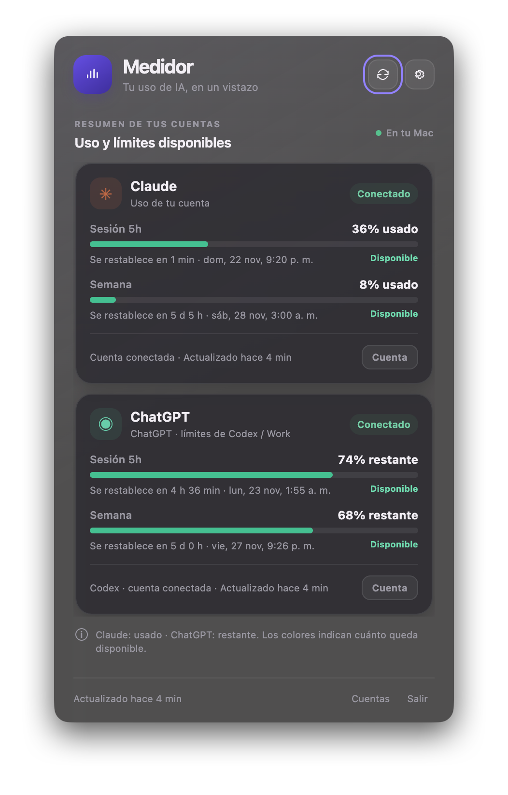
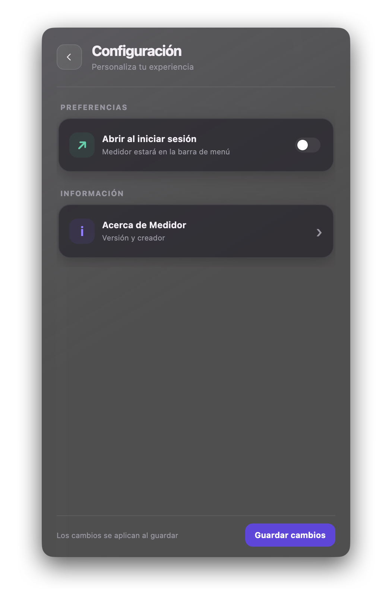
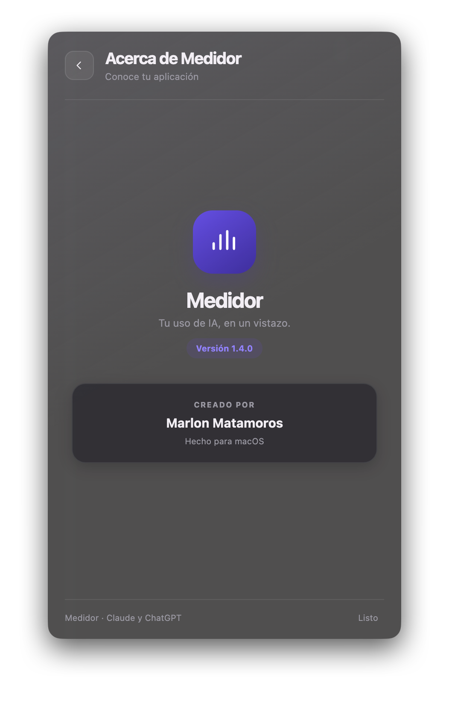

# Monitor Uso IA Bar · Medidor

Medidor es una app de barra de menú para consultar el uso de Claude y los límites de Codex/Work de ChatGPT. Se abre con el texto **IA** en la barra superior del Mac. La aplicación es una copia actualizada del proyecto original de Marlon Matamoros.

De un vistazo muestra el consumo y el tiempo de renovación de cada servicio, con indicadores de color que cambian según la disponibilidad. También permite conectar las cuentas, actualizar los datos manualmente y configurar el inicio junto con macOS.

**Creado por:** Marlon Matamoros · **Versión:** 1.4.0 · **Plataforma:** macOS

## Capturas de pantalla

| Panel de uso | Configuración | Acerca de Medidor |
| --- | --- | --- |
|  |  |  |

## Uso

1. Cierra la versión anterior de Medidor antes de abrir `Medidor_1.4.app`.
2. Haz clic en **IA** para abrir el panel. Clic derecho abre el mismo panel.
3. En la tarjeta de ChatGPT, pulsa **Conectar**. Codex inicia el acceso y abre tu navegador predeterminado. Inicia sesión normalmente, incluido el acceso con Google, y vuelve a Medidor. La autorización puede pedirte acceso al Llavero de macOS.
4. Claude utiliza la misma sesión de Medidor que en la versión anterior. Si necesitas abrir la página de inicio de sesión, pulsa **Conectar** en Claude. Google puede rechazar el acceso dentro de esa ventana integrada; el botón «Ver uso de Claude en el navegador» abre la página oficial para consulta, pero no transfiere la sesión al panel.
5. **Cuentas** permite consultar el estado y desconectar cada proveedor. Al desconectar ChatGPT se cierra solamente la sesión aislada de Medidor.
6. La actualización automática ocurre cada cinco minutos mientras la app está abierta; también puedes pulsar el icono de actualizar.

## Qué representan las cifras

- Claude muestra **porcentaje usado**, mientras ChatGPT muestra **porcentaje restante**, igual que la página del plan. Por ejemplo, 64 % usado equivale a 36 % restante. La barra usa la misma medida que el número mostrado.
- Los colores indican disponibilidad: verde con 50–100 % restante, ámbar con 20–49 % y rojo con menos del 20 %. El texto indica también el estado. Los datos anteriores se muestran en gris y se identifican como «Dato anterior».
- Se muestra el tiempo estimado hasta el reinicio y la fecha/hora local cuando el proveedor las informa. No se infiere un reinicio efectivo hasta recibir datos actualizados.
- ChatGPT muestra los límites de **Codex/Work** devueltos por el servidor oficial de Codex. Esto no pretende representar todos los límites de todos los modelos de ChatGPT. Si no se ha conectado o no hay datos, no se muestran porcentajes inventados.
- Claude conserva las consultas a interfaces privadas de claude.ai que ya usaba el proyecto original. Pueden cambiar o dejar de funcionar. La app muestra «Dato anterior» si una consulta falla y conserva una observación previa.
- Se retiró el menú extenso de clic derecho, los costos estimados y el respaldo automático de registros locales de Codex. No se muestran como si fueran consumo en tiempo real.

## Seguridad y privacidad

Para ChatGPT, Medidor invoca el Codex instalado en `/Applications/ChatGPT.app` o una instalación estándar de Codex CLI. Usa un directorio propio para esta aplicación y configura Codex para guardar sus credenciales en el Llavero de macOS. No lee ni copia cookies del navegador, contraseñas ni la sesión de otro Codex; la pantalla recibe solo estados, porcentajes y fechas. Codex puede actualizar sus credenciales de esa sesión aislada.

Para Claude se conserva la sesión local anterior del navegador integrado de Medidor. Para cerrar una sesión usa **Cuentas → Desconectar → Cerrar sesión**. Las claves administrativas anteriores, si existían, no se borran ni se usan en esta versión.

## Código y reconstrucción

El código está en `fuente/`. Ejecuta `node --test fuente/tests/*.test.js` para las pruebas. Para construir desde esta copia, utiliza `MEDIDOR_OUTPUT_APP="$PWD/Medidor_1.4.app" bash fuente/empaquetar.sh`. La construcción requiere una copia original de Medidor que incluya Electron; por defecto el script busca `~/Documents/Medidor/Medidor.app` y crea otra app sin modificar la original. Si la ruta original cambia, define `MEDIDOR_ORIGINAL_APP`. El código de este repositorio por sí solo no incluye el ejecutable de Electron ni crea una app sin esa dependencia.

La firma es local ad hoc y la app no está notarizada por Apple. No desactives Gatekeeper globalmente.
